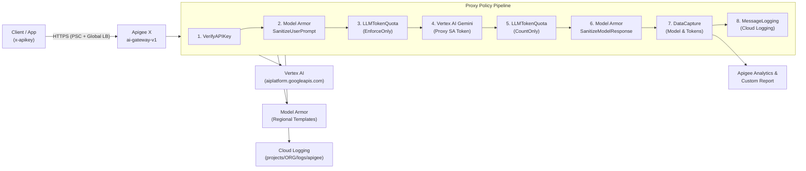

# Apigee X AI Gateway Quickstart (Terraform)

A customer-shareable, end-to-end Terraform starter repository that provisions **Apigee X** (non-peered / Private Service Connect), a dedicated **Proxy Runtime Service Account**, **Model Armor** prompt & response sanitization templates, **Data Collectors**, a **Custom LLM Consumption Report**, **API Product** (with LLM Token Quota), **Developer**, **Developer App**, and deploys the **`ai-gateway-v1`** proxy targeting **Vertex AI Gemini**.

## Architecture



## What Is Provisioned

| Component | Resource / Name | Purpose |
|---|---|---|
| **Apigee X** | Organization, Instance, `dev` Env, EnvGroup, Analytics Add-on | Non-peered Apigee X (`PAYG` or `SUBSCRIPTION`) with northbound PSC + Global External HTTPS Load Balancer |
| **Service Account** | `apigee-ai-gateway-sa` | Dedicated proxy runtime SA with `roles/aiplatform.user`, `roles/modelarmor.user`, `roles/logging.logWriter`, and `roles/iam.serviceAccountTokenCreator` for the Apigee service agent |
| **Model Armor** | `apigee-sanitize-user-prompt`, `apigee-sanitize-model-response` | Prompt injection / jailbreak / RAI / malicious URI screening on requests; RAI + SDP screening on responses |
| **AI Gateway Proxy** | `ai-gateway-v1` (`/ai/v1`) | Supports Vertex AI Gemini `:generateContent` and `:streamGenerateContent?alt=sse` |
| **Data Collectors** | `dc_model_name`, `dc_prompt_token_count`, `dc_candidates_token_count`, `dc_total_token_count` | Captures per-request model and token usage into Apigee Analytics |
| **Custom Report** | `llm-consumption-report` | Aggregates prompt, candidate, and total tokens by `dc_model_name`, `api_product`, and `developer_app` |
| **Product, Dev & App** | `ai-gateway-product`, `ai-developer@example.com`, `ai-gateway-quickstart-app` | Configures `llmOperationGroup` with `llmTokenQuota` (default: 1,000 tokens / minute) and outputs an API key |

## Prerequisites

- [Terraform](https://developer.hashicorp.com/terraform/install) `>= 1.5`
- [Google Cloud CLI (`gcloud`)](https://cloud.google.com/sdk/docs/install) authenticated (`gcloud auth login` and `gcloud auth application-default login`)
- A GCP Project with billing enabled and Owner / Editor + IAM Admin permissions
- `curl` and `python3`

## Quickstart

1. **Configure your project variables:**

   ```bash
   cp terraform/terraform.tfvars.example terraform/terraform.tfvars
   ```

   Edit `terraform/terraform.tfvars` and set `project_id` (and optionally `region`, `billing_type`, `gemini_model`, `llm_token_quota_limit`).

2. **Deploy everything with a single command:**

   ```bash
   ./scripts/setup.sh
   ```

   > **Note:** Provisioning a brand-new Apigee X organization and instance takes ~30–45 minutes, and the Google-managed SSL certificate for the external HTTPS Load Balancer can take up to ~60 minutes to become `ACTIVE` after DNS/nip.io propagation.

3. **Run verification tests:**

   ```bash
   ./scripts/verify.sh
   ```

   This verifies:
   - Missing API key returns `HTTP 401`
   - Valid Gemini request returns `HTTP 200` with `x-gateway-total-tokens` header
   - Prompt injection is blocked by Model Armor
   - Repeated requests trigger `HTTP 429` via `LLMTokenQuota`
   - Custom report exists and `MessageLogging` entries appear in Cloud Logging

## Sample Request

```bash
curl -sS -X POST \
  "$(terraform -chdir=terraform output -raw gateway_url)/models/gemini-2.5-flash:generateContent" \
  -H "Content-Type: application/json" \
  -H "x-apikey: $(terraform -chdir=terraform output -raw api_key)" \
  -d '{
    "contents": [
      {"role": "user", "parts": [{"text": "Explain Apigee AI Gateway in one sentence."}]}
    ]
  }'
```

### Streaming (SSE)

```bash
curl -N -sS -X POST \
  "$(terraform -chdir=terraform output -raw gateway_url)/models/gemini-2.5-flash:streamGenerateContent?alt=sse" \
  -H "Content-Type: application/json" \
  -H "x-apikey: $(terraform -chdir=terraform output -raw api_key)" \
  -d '{
    "contents": [
      {"role": "user", "parts": [{"text": "Count from 1 to 5."}]}
    ]
  }'
```

## Cleanup

```bash
./scripts/destroy.sh
```

## License

Apache License 2.0 — see [LICENSE](LICENSE).
